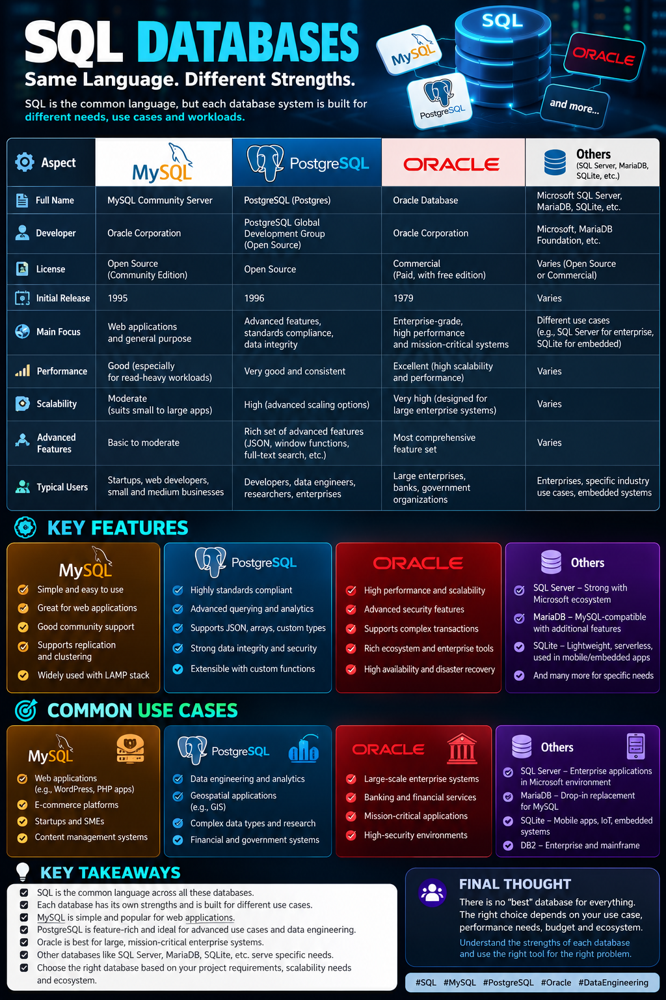

# SQL Databases Explained: MySQL vs PostgreSQL vs Oracle vs SQL Server

## 1. Introduction

Databases are an essential part of modern software applications and data engineering systems. They store, organize, manage, and retrieve the data that powers websites, enterprise applications, analytics platforms, and business operations.

When learning SQL, we often encounter names such as MySQL, PostgreSQL, Oracle Database, and Microsoft SQL Server.

Although these technologies share many concepts, they are not identical.

**SQL is a query language, whereas MySQL, PostgreSQL, Oracle Database, and Microsoft SQL Server are database management systems that support SQL.**

Understanding their differences, functionalities, and use cases helps developers and data engineers select the right database for a particular requirement.

---

## 2. What Is SQL?

SQL stands for **Structured Query Language**.

It is used to communicate with relational databases to perform operations such as:

- Retrieving data using `SELECT`
- Filtering records using `WHERE`
- Inserting data using `INSERT`
- Updating records using `UPDATE`
- Deleting records using `DELETE`
- Combining tables using `JOIN`
- Aggregating data using `GROUP BY`
- Managing database structures using `CREATE`, `ALTER`, and `DROP`

### Example

```sql
SELECT employee_name, salary
FROM employees
WHERE salary > 35000
ORDER BY salary DESC;
```

This query retrieves employee names and salaries for employees earning more than 35,000, ordered from highest salary to lowest.

The fundamental SQL concepts transfer across many relational database systems, although syntax and supported features vary.

---

## 3. What Is a DBMS and an RDBMS?

### DBMS — Database Management System

A DBMS is software that enables users and applications to store, retrieve, manage, and maintain data.

### RDBMS — Relational Database Management System

An RDBMS organizes data into tables consisting of rows and columns. Relationships between tables can be established using keys and constraints.

For example, an e-commerce application may maintain the following tables:

- `Customers`
- `Products`
- `Orders`
- `Payments`

A customer identifier can connect a customer record to their orders, allowing the database to maintain structured and related information.

MySQL, PostgreSQL, Oracle Database, and Microsoft SQL Server are examples of relational database management systems.

---

## 4. MySQL

### Overview

MySQL is an open-source relational database management system widely used for websites, web applications, and application backends.

It is commonly associated with web development stacks and is supported by a large developer ecosystem.

### Key Features

- Relational data storage and SQL querying
- Transactions and constraints with supported storage engines
- Indexing and query optimization
- Replication and high-availability options
- Integration with Python, PHP, Java, and other programming languages
- Community and commercial support options

### Common Use Cases

- E-commerce websites
- Content management systems
- Web application backends
- Small and medium-sized business applications
- Application databases

### Advantages

- Widely adopted and well documented
- Strong ecosystem for web applications
- Straightforward to get started with
- Multiple deployment and management options

### Considerations

Its capabilities and performance depend on the storage engine, configuration, workload, schema design, and deployment architecture. Advanced SQL features can differ from those available in PostgreSQL or other database systems.

Official documentation: https://dev.mysql.com/doc/

---

## 5. PostgreSQL

### Overview

PostgreSQL is a powerful open-source relational database management system known for its standards-oriented SQL implementation, extensibility, and rich set of advanced features.

It is used in application development, data-intensive systems, analytics workloads, and data engineering projects.

### Key Features

- Advanced SQL querying and window functions
- Common Table Expressions (CTEs)
- Strong transactional support
- Constraints and referential integrity
- JSON and JSONB data types
- Indexing and query optimization
- Extensible functions, operators, and data types
- Support for custom extensions

### Common Use Cases

- Data-intensive backend applications
- Financial and transactional systems
- Analytical applications
- Data ingestion and transformation pipelines
- Applications requiring complex queries and relational integrity

### Advantages

- Open-source and feature-rich
- Strong support for complex queries
- Extensive data types and extensibility
- Useful for learning advanced SQL and database design

### Considerations

Performance and scalability depend on schema design, indexing, workload, configuration, and infrastructure. PostgreSQL still requires appropriate monitoring, backup planning, and database administration in production.

Official documentation: https://www.postgresql.org/docs/

---

## 6. Oracle Database

### Overview

Oracle Database is a relational database management system widely used in enterprise environments that require sophisticated data management, security, availability, and administration capabilities.

Oracle also provides its own procedural extension to SQL, called **PL/SQL**, for writing database-side programs.

### Key Features

- Transaction management
- Enterprise security and access controls
- High-availability and disaster-recovery capabilities
- Backup and recovery facilities
- Performance monitoring and tuning
- Partitioning and other advanced data-management capabilities, depending on edition and licensing
- PL/SQL for stored procedures, functions, and packages

### Common Use Cases

- Banking and financial systems
- Large enterprise applications
- Mission-critical transactional systems
- Government and telecommunications platforms
- Complex enterprise database environments

### Advantages

- Extensive enterprise features
- Mature administration and monitoring ecosystem
- Options for high availability and recovery
- Broad support for demanding business applications

### Considerations

Licensing, infrastructure, administration, and operational complexity must be considered when selecting an Oracle deployment. Available capabilities vary by product, edition, and licensing arrangement.

Official documentation: https://docs.oracle.com/en/database/

---

## 7. Microsoft SQL Server

### Overview

Microsoft SQL Server is a relational database management system commonly used in enterprise applications and Microsoft's data ecosystem.

Its SQL dialect is known as **Transact-SQL (T-SQL)**.

### Key Features

- Relational data storage and transactions
- Stored procedures and functions
- Query optimization and indexing
- Security and administration tools
- Backup and recovery
- Business intelligence and analytics integrations
- Integration with Microsoft data tools, including Power BI

### Common Use Cases

- Enterprise application databases
- Reporting and business intelligence
- Corporate data platforms
- Transactional business systems
- Organizations using Microsoft technologies

### Advantages

- Strong integration with Microsoft technologies
- Extensive administration and development tooling
- Useful for enterprise reporting workflows
- Multiple deployment and licensing options

### Considerations

SQL Server has its own syntax and product-specific features. Edition, licensing, deployment environment, and workload affect which capabilities are available.

Official documentation: https://learn.microsoft.com/en-us/sql/

---

## 8. Other Important Database Systems

### SQLite

SQLite is a lightweight, serverless relational database engine that stores a database in a local file.

**Common uses:**
- Mobile applications
- Embedded systems
- Desktop applications
- Prototypes and local development
- SQL practice and small projects

Unlike PostgreSQL and MySQL in their usual server-based deployments, SQLite does not require a separate database server process.

Official documentation: https://www.sqlite.org/docs.html

### MariaDB

MariaDB is an open-source relational database management system that originated as a fork of MySQL.

It is used in web applications, backend systems, and other relational database workloads.

Although MariaDB is compatible with many MySQL interfaces and workflows, compatibility is not universal across every feature or version.

Official documentation: https://mariadb.org/documentation/

### Other Systems

Depending on the workload, developers may also encounter:

- IBM Db2 — enterprise and transactional database workloads
- Snowflake — cloud data warehousing and analytics
- Amazon Redshift — cloud data warehousing
- DuckDB — analytical processing, particularly local and embedded analytical workloads

These systems have different architectures and intended use cases. Not every data platform is a traditional relational database server.

---

## 9. Comparison: MySQL vs PostgreSQL vs Oracle vs SQL Server

| Feature | MySQL | PostgreSQL | Oracle Database | SQL Server |
|---|---|---|---|---|
| Primary focus | General-purpose and web applications | Advanced relational workloads and extensibility | Enterprise data management | Enterprise applications and Microsoft ecosystem |
| SQL dialect | MySQL SQL | PostgreSQL SQL | Oracle SQL and PL/SQL | T-SQL |
| Licensing | Open-source community edition and commercial options | Open-source | Commercial and other edition-specific options | Commercial and edition-specific options |
| Advanced SQL | Broad feature set | Rich advanced SQL capabilities | Rich enterprise SQL capabilities | Rich T-SQL capabilities |
| JSON support | Yes | Yes, including JSONB | Yes, with feature and version differences | Yes, with feature and version differences |
| High availability | Replication and related options | Replication and related options | Extensive enterprise options | Enterprise availability options |
| Common ecosystem | Web applications | Backend, data-intensive and analytical applications | Large enterprises | Microsoft enterprise and BI environments |

**Important:** Performance, scalability, and reliability cannot be ranked universally. They depend on the workload, architecture, configuration, hardware, licensing, and operational requirements.

---

## 10. SQL Dialects: Why Syntax Can Differ

Although these systems support SQL, each has its own dialect and extensions.

For example, limiting query output differs between systems.

### PostgreSQL and MySQL

```sql
SELECT *
FROM employees
LIMIT 5;
```

### Microsoft SQL Server

```sql
SELECT TOP 5 *
FROM employees;
```

### Oracle Database

```sql
SELECT *
FROM employees
FETCH FIRST 5 ROWS ONLY;
```

Modern versions of these systems support several common SQL constructs, but exact compatibility depends on the feature and version.

Learning one database well provides a foundation for learning others.

---

## 11. Which Database Should You Choose?

The best database depends on the problem being solved.

| Requirement | Possible choice |
|---|---|
| Web application backend | MySQL or PostgreSQL |
| Advanced relational querying | PostgreSQL |
| Enterprise Oracle environment | Oracle Database |
| Microsoft enterprise and BI ecosystem | SQL Server |
| Lightweight local application | SQLite |
| Cloud analytical warehouse | Snowflake, Redshift, or another suitable warehouse |

These are starting points, not strict rules. Production decisions should account for workload requirements, cost, operational expertise, security, ecosystem, and existing infrastructure.

---

## 12. Why PostgreSQL Is a Good Starting Point for Data Engineering

Data Engineering involves collecting, transforming, validating, storing, and delivering reliable data to downstream applications and analytics systems.

PostgreSQL provides a practical learning environment for building this foundation.

With PostgreSQL, you can learn:

1. Relational database design
2. SQL querying and transformations
3. Constraints and data integrity
4. Joins and analytical queries
5. Indexes and query plans
6. Python-to-database connectivity
7. Data loading and incremental processing
8. The database layer of an ETL pipeline

A future data engineering workflow might look like this:

```text
Source API / Raw Files
          |
          v
     Python ETL
          |
          v
 Data Validation
          |
          v
    PostgreSQL
          |
          v
 Data Warehouse / Analytics
```

As the system grows, orchestration, cloud storage, data warehouses, and distributed processing tools can be introduced when required.

---

## 13. Key Takeaways

- SQL is a language, not a database management system.
- MySQL, PostgreSQL, Oracle Database, and SQL Server are different systems that support SQL.
- SQLite is a lightweight database engine suited to local and embedded use cases.
- Each system has different features, licensing models, operational requirements, and strengths.
- SQL knowledge transfers between systems, but dialect differences matter.
- PostgreSQL is a useful starting point for learning relational databases and building data engineering projects.
- Choosing a database requires understanding the application's workload and requirements.

**Final Thought**

A good developer or data engineer does not choose a database simply because it is popular. They understand the problem, evaluate the available technologies, and select the system that best fits the requirements.

*Learning SQL is the first step. Understanding how databases work together with applications, pipelines, and analytics systems is what helps build a stronger foundation in Data Engineering.*

---

## References

- MySQL Documentation: https://dev.mysql.com/doc/
- PostgreSQL Documentation: https://www.postgresql.org/docs/
- Oracle Database Documentation: https://docs.oracle.com/en/database/
- Microsoft SQL Server Documentation: https://learn.microsoft.com/en-us/sql/
- SQLite Documentation: https://www.sqlite.org/docs.html
- MariaDB Documentation: https://mariadb.org/documentation/

## Topics

`SQL` · `MySQL` · `PostgreSQL` · `Oracle Database` · `SQL Server` · `Database Management Systems` · `Data Engineering` · `Relational Databases`
